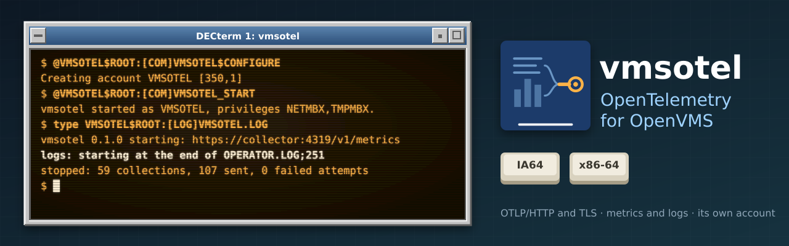

<p align="center">
  
</p>

# vmsotel

[](https://github.com/issinoho/vmsotel/releases/latest)
[](https://github.com/issinoho/vmsotel/releases)

[](LICENSE)

An [OpenTelemetry](https://opentelemetry.io) agent for **OpenVMS** (x86-64,
Integrity/IA64, Alpha and VAX). It reads the system services and sends this system's metrics
and, if you ask, its operator log and audit journal to an OpenTelemetry
collector over **OTLP/HTTP**, with or without TLS. From the collector they go
wherever your other systems' telemetry goes: Prometheus, Grafana, Elastic,
Datadog, Splunk or anything else that takes OTLP.

It is written for OpenVMS from scratch in C99, with no C++ and nothing to
port: VSI C on x86-64, IA64 and Alpha, VSI's OpenSSL 3 kit for TLS, and Compaq C
on VAX, where it is C89 and sends plain HTTP (there is no OpenSSL for VAX). It connects
out to the collector, so nothing listens on the VMS system. Installed from the
kit, it runs as an account of its own, never as SYSTEM, with only the
privileges its configuration needs.

Part of the same family as [the beszel agent](https://github.com/issinoho/vms-beszel),
[VTOP](https://github.com/issinoho/vms-vtop), [Steward](https://github.com/issinoho/vms-steward)
and the other [ports and tools for OpenVMS](https://openvms.issinoho.com).

## What it sends

**System metrics**, every minute by default, named as the collector's own
`hostmetrics` receiver names them on Linux, so the same dashboards mostly just
work:

| Metric | From |
| --- | --- |
| `system.cpu.time` by VMS mode (user, supervisor, executive, kernel, interrupt, MP synch, idle) and `system.cpu.logical.count` | `$GETRMI`, `$GETSYI` |
| `system.memory.usage` (used, free, modified) and `system.memory.limit` | `$GETRMI`, `$GETSYI` |
| `system.paging.usage`, `system.paging.faults`, `system.paging.operations` | page files, `$GETRMI` |
| `system.disk.operations`, `system.filesystem.usage` per mounted disk | `$DEVICE_SCAN`, `$GETDVI` |
| `system.process.count` by state, `system.uptime` | `$GETJPI`, `$GETSYI` |
| `openvms.io.direct`, `openvms.io.buffered` | `$GETRMI` |

Each export carries `host.name`, `host.arch`, `host.type`, `os.type`
(`openvms`), `os.version`, `openvms.scsnode` and `openvms.cluster.member`,
plus any `resource.*` attributes you add.

**Chosen processes** (optional): CPU time and memory for processes picked by
name or username, with VMS wildcards (`process.name = MARIADBD*`,
`process.user = LIGHTTPD`). Needs WORLD.

**Logs** (optional): the operator log (`OPCOM` messages) and the security
audit journal as OTLP log records, each with its own timestamp. Audit records
are decoded: login failures and break-in attempts arrive as WARN, with the
user, remote node, terminal, process and status as attributes. Passwords and
command lines are never sent. The agent follows `REPLY/LOG` and
`SET AUDIT/SERVER=NEW_LOG` to the new files. Needs READALL.

**Its own health**: `vmsotel.exports` by outcome, `vmsotel.queue.length`,
`vmsotel.collection.duration` and `vmsotel.clock.skew`. When the collector is
down it keeps a bounded queue and drops the oldest metrics first, so a
monitoring outage can never fill a VMS system's memory or disk.

## Downloads

From the [latest release](https://github.com/issinoho/vmsotel/releases/latest):

| Kit | Platform |
|---|---|
| `ISSINOHO-I64VMS-VMSOTEL-V0001-0-1.PCSI` | OpenVMS IA64 (built and tested on V8.4-2L3) |
| `ISSINOHO-X86VMS-VMSOTEL-V0001-0-1.PCSI` | OpenVMS x86-64 (built and tested on E9.2-4) |
| `ISSINOHO-VMS-VMSOTEL-V0001-0-1.PCSI` | OpenVMS VAX (built and tested on V7.3) |
| `ISSINOHO-AXPVMS-VMSOTEL-V0001-0-1.PCSI` | OpenVMS Alpha (built and tested on V8.4-2L2) |

`SHA256SUMS` lists the SHA-256 of each kit. Requires VSI TCP/IP Services and
VSI's SSL3 kit; on VAX, TCP/IP Services only (tested with V5.1). There is no
OpenSSL for VAX, so the agent sends plain HTTP there, without TLS. VAX's PCSI
has no `/OPTIONS`, so `PRODUCT INSTALL` asks before it goes ahead.

## Installing

A kit downloaded through a non-VMS system loses its record format. As SYSTEM,
restore it and install:

```dcl
$ SET FILE/ATTRIBUTE=(RFM:FIX,LRL:8192,MRS:8192,RAT:NONE) ISSINOHO-*-VMSOTEL-V0001-0-1.PCSI
$ PRODUCT INSTALL VMSOTEL /PRODUCER=ISSINOHO /SOURCE=dev:[dir]
```

The kits are not signed, so PCSI notes that it cannot validate a signature.
The product goes in `[VMSOTEL]` under the destination (`SYS$COMMON:` by
default), rooted by `VMSOTEL$ROOT`.

Then, once, create the agent's account and its configuration:

```dcl
$ @VMSOTEL$ROOT:[COM]VMSOTEL$CONFIGURE
```

It asks for the account (default `VMSOTEL`) and its UIC: a group of its own,
above `MAXSYSGROUP`, that no other account uses (it checks). The account
cannot log in by any route, but the agent runs as it. Its authorized
privileges are NETMBX and TMPMBX, plus WORLD and READALL only if the
configuration asks for processes or logs. Run it again after turning those on.

## Using it

Set `host` to your collector in `VMSOTEL$ROOT:[CONF]VMSOTEL.CONF`. The file
was made from `VMSOTEL.CONF_EXAMPLE`, which explains every setting. Then:

```dcl
$ @VMSOTEL$ROOT:[COM]VMSOTEL_START
$ TYPE VMSOTEL$ROOT:[LOG]VMSOTEL.LOG
$ @VMSOTEL$ROOT:[COM]VMSOTEL_STOP
```

`VMSOTEL_STOP` asks the agent to stop. It makes one more attempt to send what
it has queued, then logs a summary. To start at boot and stop at shutdown, add
to `SYSTARTUP_VMS.COM` (after TCP/IP) and `SYSHUTDWN.COM`:

```dcl
$ @SYS$STARTUP:VMSOTEL$STARTUP.COM
$ @SYS$STARTUP:VMSOTEL$SHUTDOWN.COM
```

The main settings:

```
host = otel.example.com       # the collector
port = 4318                   # OTLP/HTTP
interval = 60                 # seconds between collections
tls = yes                     # always verified, against cafile or the system CAs
cafile = VMSOTEL$ROOT:[CONF]COLLECTOR.CRT
process.name = MARIADBD*      # chosen processes (WORLD)
logs.opcom = yes              # the operator log (READALL)
logs.audit = yes              # the audit journal (READALL)
resource.deployment.environment = production
```

To check what it reads, without sending anything, compare its self-test with
SHOW and MONITOR:

```dcl
$ VMSOTEL := $VMSOTEL$ROOT:[BIN]VMSOTEL.EXE
$ VMSOTEL --SELFTEST
```

[`docs/operations.md`](docs/operations.md) explains every line the agent logs,
and how to check its numbers against MONITOR.

### The collector

Any OpenTelemetry Collector with the OTLP receiver will do. It needs a
`metrics` pipeline, and a `logs` pipeline if you send logs; without one, the
agent logs `HTTP 404 on /v1/logs` and says why. Recent collectors listen on
localhost only unless told otherwise:

```yaml
receivers:
  otlp:
    protocols:
      http:
        endpoint: 0.0.0.0:4318
service:
  pipelines:
    metrics: { receivers: [otlp], exporters: [your-exporter] }
    logs:    { receivers: [otlp], exporters: [your-exporter] }
```

For dashboards from scratch, `collector/grafana/` is a Docker Compose stack:
the collector, Prometheus for metrics, Loki for logs, and Grafana with an
OpenVMS host dashboard (`docs/operations.md`, "Dashboards").

Keep the VMS clock right (NTP): every timestamp is taken from it. The agent
compares it with the collector's at every export and logs a warning when they
differ by more than 2 s.

## Tested

The kits are built natively and have run on an x86-64 E9.2-4 system and an
Integrity rx2660 on V8.4-2L3 against OpenTelemetry Collector 0.111.0:
- The self-test matched SHOW and MONITOR.
- Per-process CPU and memory equalled SHOW SYSTEM.
- Operator-log and audit records arrived with their own timestamps.
- TLS exports were verified, and refused without the right certificate.
- A clock set back did not stall the agent.
- Rotated logs were followed without loss.

On a VAXserver 3900 (SIMH) on V7.3, the agent was built by `build_vms` and
MMS, its self-test matched SHOW and MONITOR, it ran detached for an hour with
processes and both logs, ran unprivileged, and its kit installed, started the
agent as its own account at a (simulated) boot, and was removed.

On an AlphaServer DS10L (Charon-AXP) on V8.4-2L2, the self-test matched SHOW
and MONITOR, exports reached the collector with the right values, per-process
CPU and memory equalled SHOW SYSTEM over an hour detached, an operator-log
record arrived with its own timestamp, TLS exports were verified against the
collector's certificate, it ran unprivileged, and its kit installed, started
the agent as its own account, and was removed. `build_vms` and MMS both
built it.

[`docs/findings.md`](docs/findings.md) has every result, with the evidence
from each machine.

## Building from source

On OpenVMS, from the directory that is to hold it (type git subcommands in
lowercase):

```dcl
$ git clone https://github.com/issinoho/vmsotel.git
$ @[.vmsotel]build_vms SELFTEST
$ @[.vmsotel.kit]make_kit
```

`build_vms` builds `VMSOTEL.EXE`, `VMSOTEL_TLS.EXE` and `VMSOTEL_LAUNCH.EXE` in
`[.vmsotel.build]`. `SELFTEST` prints every value it reads beside the SHOW or
MONITOR command that shows the same number. `descrip.mms` builds the same with
`MMS` (type `MMS CLEAN` in capitals). `make_kit` writes the PCSI kit to
`[.vmsotel.KIT_<arch>]`. A source tree can also be run directly, as whoever
starts it: see [`docs/operations.md`](docs/operations.md).

VAX has no git: copy the tree over (FTP), with `vmsotel.conf.example` as
`VMSOTEL.CONF_EXAMPLE`. There `build_vms` builds `VMSOTEL.EXE` and
`VMSOTEL_LAUNCH.EXE` only, and MMS needs `MMS/MACRO=VAX=1`.

## For developers

Most of the work is done on Linux, against stand-ins for the VMS system
services, before anything costs a round trip to a VMS machine:

```sh
make check
```

That runs:
- The unit tests.
- The encoder's golden payloads (`tests/golden/`), checked against the OTLP schema.
- The agent against a fake collector: retries, `Retry-After`, rejection, a collector that is down, TLS verification, clock skew, and logs.
- The VMS source and the kit's launcher, against `stub/`.
- Checks that the three build files and the kit's file list agree.

With `opentelemetry-proto` installed (`PYTHON=/path/to/venv/bin/python make
check`), every payload is parsed against the official schema.

`tools/vms.sh` runs things on VMS machines that take SSH key login: copy
`tools/nodes.conf.example` to `tools/nodes.conf` and fill in each node, then
`tools/vms.sh NODE put FILE`, `tools/vms.sh NODE dcl 'COMMAND'`, or
`tools/vms.sh NODE batch PROC.COM` for anything that runs for more than a
minute.

- [`docs/design.md`](docs/design.md): the design, and the reasons behind it
- [`docs/findings.md`](docs/findings.md): what the probes and the agent showed on each machine
- [`CLAUDE.md`](CLAUDE.md): the working notes and constraints (C99, 32-bit item lists, three build files)
- `src/`: `model/` (one reading of the system), `otlp/` (the OTLP JSON encoder), `platform/`, `transport/` (HTTP, TLS over memory BIOs, the queue), `sources/` (VMS and fake), `agent/`, `launch/` (the kit's launcher)
- `probes/`: the programs that answered the design's questions on each machine, before the code relied on the answers
- `kit/`: the PCSI kit; `collector/`: the test collector's configuration

It started inside [vmsguard](https://github.com/issinoho/vmsguard) and was moved
here with its history; the two share no code.

## Licence

MIT; see [LICENSE](LICENSE). OpenTelemetry and OTLP are projects of the Cloud
Native Computing Foundation; vmsotel is independent of them.
